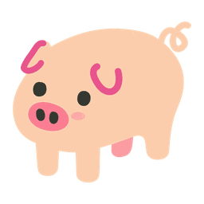
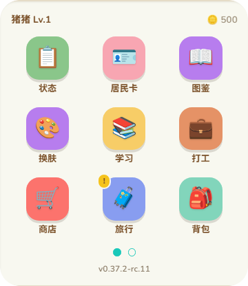

<p align="center"></p>

<h1 align="center">dsh-piggy</h1>

<p align="center">一只住在 <a href="https://github.com/deepseek-ai/deepseek-harness">DeepSeek Harness</a> 里，也能独立住在桌面上的猪。</p>

<p align="center">
  <a href="https://github.com/CLICGGER-TYPES/dsh-piggy/releases"></a>
  <a href="https://www.npmjs.com/package/dsh-piggy"></a>
  
  <a href="LICENSE"></a>
</p>

<p align="center"></p>

养一只会长大、上学、打工、旅行，也会跟你搭话的小猪。QQ 宠物式的单机养成，动森 NookPhone 风格的界面；同一份代码提供两种形态：住在 DeepSeek Harness 网页里的 DSH 插件，和独立的桌面版。

鼠标就能完成全部玩法。忙的时候，它会用背包里的东西照顾自己。游戏不注册模型工具，也不向对话注入宠物状态，照顾小猪不消耗模型 token。

## 亮点

- **养成**：最高 60 级，33 种职业，15 个旅行地点，12 种性格，1008 句台词。
- **菜园**：29 种作物、18 块地，按真实时间生长；浇水、除草、杀虫、施肥、多季收获，可雇帮工并安排巡逻。
- **小游戏**：20 层矿洞、盲盒与扭蛋、40 种鱼的钓鱼、番茄钟。
- **桌面多猪**：最多 4 个宠物窗口，共享同一 owner 的金币、背包和菜园。
- **本地优先**：存档在你自己机器上；云同步和局域网联机都默认关闭，需要时显式开启。
- **可扩展**：皮肤包、动作/音效素材包、在线扩展，都有格式校验和回退。

## 两种形态

| | DSH 插件 | 桌面版 |
|---|---|---|
| 运行位置 | DeepSeek Harness 页面内 | 独立 Electron 应用 |
| 安装 | `dsh plugin add` | 下载安装包或便携版 |
| 小猪 | 单猪 | 单猪，最多 4 个窗口 |
| 存档 | DSH 自己的存档 | 本地 userData，可导入 DSH 存档 |
| 适合 | 边工作边养 | 常驻桌面、多猪、托盘 |

两边的猪默认各自独立；需要合并时走导出/预览/备份后的完整档迁移，不会静默覆盖。

## 快速开始

### DSH 插件

```sh
dsh plugin --profile web add dsh-piggy
```

安装后重启 DSH 并刷新页面。也可以安装别名包 [`dsh-plugin-piggy`](https://www.npmjs.com/package/dsh-plugin-piggy)，同一个 profile 只需装其中一个。

> 不带版本号安装 npm `latest`。想用预览版请显式指定版本，例如 `dsh-piggy@0.37.2-rc.15`；npm 标签和 GitHub Release 可能不同步，以发布页为准。

### 桌面版

从 [Releases](https://github.com/CLICGGER-TYPES/dsh-piggy/releases) 下载：

| 系统 | 文件 |
|---|---|
| Windows | `setup.exe` 安装版，或 `portable.exe` 便携版 |
| Linux | `AppImage`，添加执行权限后运行 |
| macOS | Apple 芯片选 `arm64.dmg`，Intel 选 `x64.dmg` |

macOS 包暂未签名，第一次打开请在访达中右键应用并选择“打开”。国内 Windows 用户可使用[夸克网盘](https://pan.quark.cn/s/0ef88e5bda2d)。

## 玩法

1. 第一次见到“猪递”纸盒时，连续点三下，把猪接回家。
2. 左键摸摸它，右键打开主菜单；桌面版拖动小猪可以换位置。
3. 从商店买食物、洗浴用品和玩具，用背包里的东西照顾它。离线照顾默认开启。
4. 想种菜、挖矿、抽扭蛋或盲盒，去「设置 → 扩展」安装对应玩法。

完整规则见[玩法指南](docs/guides/gameplay.md)。

## 文档

| 文档 | 内容 |
|---|---|
| [桌面版安装与存档](docs/guides/desktop.md) | 安装、数据目录、迁移 |
| [玩法指南](docs/guides/gameplay.md) | 养成、菜园、矿洞、钓鱼、番茄钟 |
| [外部桌宠](docs/guides/external-pet.md) | DSH 与桌面猪的连接和合并 |
| [多 agent 共用一只桌宠](docs/guides/multi-agent-pet.md) | 工作事件投递、发现、429 退避 |
| [皮肤制作](docs/guides/creating-skins.md) | 自定义 PNG/SVG 皮肤 |
| [新增动作](docs/guides/adding-actions.md) / [新增音效](docs/guides/adding-sounds.md) | 素材包格式与校验 |
| [发布渠道与历史版本](docs/guides/releases.md) | 稳定版、RC、npm、夸克、Gitee |

## 开发

```sh
npm install
npm run build
npm test
npm run typecheck
```

要求 Node 22+。构建会生成 `client.js`、菜园扩展和素材版本，这些产物不提交。

## 版本与发布

- 稳定版：游戏 0.37.1 / 桌面外壳 0.6.7。
- 预览版：游戏 0.37.2-rc.15 / 桌面外壳 0.6.8-rc.11。
- npm `latest` 目前仍是 0.37.0；`rc` 标签由维护者手动发布。
- Gitee 不再发布新版本；历史附件只作回退。

发布页、校验文件和国内渠道见[发布渠道说明](docs/guides/releases.md)，逐版本变更见 [CHANGELOG](CHANGELOG.md)。

## 反馈

遇到问题时，到「设置 → 日志 → 导出日志」保存运行记录，附上游戏/外壳/扩展版本、系统和缩放、操作步骤，提交到 [GitHub Issues](https://github.com/CLICGGER-TYPES/dsh-piggy/issues)。

## 贡献者

这个项目有一半是玩家帮忙做出来的，谢谢每一位交出代码、画作和想法的朋友（按首次贡献时间排序）：

| 贡献者 | 贡献 |
|---|---|
| [@1nuoiscute](https://github.com/1nuoiscute) | 猪猪王原型与恶魔猪形态、肥猪体型和胖胖猪动作立绘；十六项成就与小猪徽章系统（[#6](https://github.com/CLICGGER-TYPES/dsh-piggy/pull/6)）；扩展公共进度事件与十二项扩展成就（[#7](https://github.com/CLICGGER-TYPES/dsh-piggy/pull/7)）；六项进阶成就与六枚互动徽章贴图（[#38](https://github.com/CLICGGER-TYPES/dsh-piggy/pull/38)，含后续高光与站姿重绘） |
| [@anupamme](https://github.com/anupamme) | 报告桌面版更新依赖的安全问题（[#5](https://github.com/CLICGGER-TYPES/dsh-piggy/pull/5)） |
| [@Skipanic](https://github.com/Skipanic) | 云存档改用 git 同步的设计（[#34](https://github.com/CLICGGER-TYPES/dsh-piggy/pull/34)）与推送、手动提交、按提交恢复实现（[#35](https://github.com/CLICGGER-TYPES/dsh-piggy/pull/35)）；为完整档云同步方向提供建议 |
| [@tetezi](https://github.com/tetezi) | 面板动作时猪窗口置顶、右键不误摸、脏和生病状态的苍蝇/病毒图标、恢复桌面版状态变色与心情优先级调整，附回归测试（[#8](https://github.com/CLICGGER-TYPES/dsh-piggy/pull/8)，随 [#9](https://github.com/CLICGGER-TYPES/dsh-piggy/pull/9) 合入） |
| [@WolalaQAQ](https://github.com/WolalaQAQ) | 运行时与 DSH 适配器拆分、工作事件接口、持久去重和事务恢复，以及后续可靠性补丁；按游戏能力控制 Windows 鼠标转发（[#19](https://github.com/CLICGGER-TYPES/dsh-piggy/pull/19)），异步外壳 I/O 与更新生命周期（[#15](https://github.com/CLICGGER-TYPES/dsh-piggy/pull/15)）、Windows 菜单与小猪窗口层级恢复及回归测试（[#21](https://github.com/CLICGGER-TYPES/dsh-piggy/pull/21)）；提出并参与可选 DSH 外部桌宠方向讨论（[#14](https://github.com/CLICGGER-TYPES/dsh-piggy/issues/14)）；并协助完成 Windows、DSH 和 OpenCode 独立复核（[#12](https://github.com/CLICGGER-TYPES/dsh-piggy/pull/12)、[#13](https://github.com/CLICGGER-TYPES/dsh-piggy/pull/13)） |
| [@Flappy-Boy](https://github.com/Flappy-Boy) | 反馈更新说明滚动回顶、菜园快速点击丢操作、矿洞连续挖掘站位异常，并提供复现步骤（[#16](https://github.com/CLICGGER-TYPES/dsh-piggy/issues/16)、[#17](https://github.com/CLICGGER-TYPES/dsh-piggy/issues/17)、[#18](https://github.com/CLICGGER-TYPES/dsh-piggy/issues/18)） |

欢迎画猪、报问题或贡献代码。当前立绘只有一套无描边平涂画风，原有形象与制作要求见[小猪画风](docs/art/pig-style.md)。可以先开 Issue 交流，也欢迎 Fork 项目，养一只符合自己喜好的猪。想加玩法、想画猪、想报 bug 都欢迎：到 [Issues](https://github.com/CLICGGER-TYPES/dsh-piggy/issues) 说一声，或直接提 [Pull Request](https://github.com/CLICGGER-TYPES/dsh-piggy/pulls)。合并进来的贡献会记在这张表里。

## 致谢与许可

**不同状态的小猪图**（`assets/pigs/feedback/`）的灵感来自 [PigHub](https://pighub.top/) 上的猪猪图片：以那里的猪猪为参考，由 AI（OpenAI 图像生成，codex 操作）重新画成本项目的样子，没有直接复制原图。谢谢 PigHub 和图片作者！如果你是原图作者，觉得侵犯了你的权利或不喜欢这样使用，请[开 issue](https://github.com/CLICGGER-TYPES/dsh-piggy/issues) 告诉我们，我们会删除相关图片。

**代码与文档**采用 [MIT License](LICENSE)。**素材按目录单独许可，不自动适用 MIT**，完整表见 [LICENSE-ASSETS.md](LICENSE-ASSETS.md)：

- 小猪立绘、形态、皮肤、徽章、反馈图：改自 [Noto Emoji](https://github.com/googlefonts/noto-emoji) 的 🐖，按 **Apache 2.0** 发布（[LICENSE-noto-emoji.txt](LICENSE-noto-emoji.txt)）。
- 钓鱼、菜园、矿洞、摸摸手等 AI 生成场景/道具：按 **CC BY 4.0** 发布。
- Noto Color Emoji 字体及网页子集：**OFL 1.1**。
- 用户提供的原摸摸 GIF：权利链不属于本项目，**不随仓库/发布包分发，也不授予再分发许可**；游戏使用拆出的 AI 生成独立手层。

视觉风格参考 [animal-island-ui](https://github.com/guokaigdg/animal-island-ui)，玩法数值参考资料见 [THIRD-PARTY.md](THIRD-PARTY.md)。第三方依赖、参考项目和商标说明也在 [THIRD-PARTY.md](THIRD-PARTY.md)。
