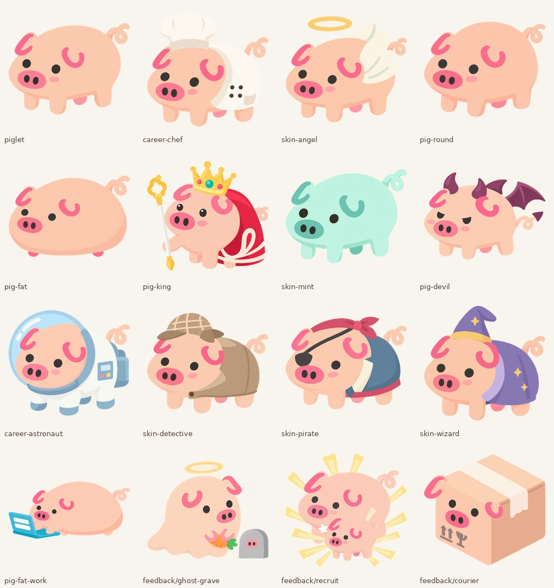

# 无描边小猪：181 张画风对照

2026-10-11，用户确认 v3 样图后，要求其余图片全部画出。成品长边 256px，已移入 assets/pigs/no-outline/，本目录保存对照页面与记录；原尺寸生成结果、各张原始参考和深浅背景预览保留在独立素材工作区，不进入游戏仓库。

完整对照页面：[index.html](index.html)。每张左边是现有黑色描边，右边是无描边候选；点图片打开独立 PNG。全量记录见 [manifest.json](manifest.json)。

| 类型 | 张数 |
|---|---:|
| 基础猪与成长阶段 | 7 |
| 内置形态 | 41 |
| 内置皮肤/职业 | 67 |
| 反馈场景 | 38 |
| 成就徽章 | 28 |
| 合计 | 181 |

## 生成与自查

- 每张调用内置 `image_gen`，以对应原图作为编辑目标，已确认 v3 仅作画风参考；逐字提示词保存在 [batch/](../../../art-prompts/no-outline/batch/)。
- 保留原有弯曲耳型、姿态、可见肢体、服装、道具、表情和状态语义。死亡灰色/X眼、检疫合格、努力头带等原有内容保留；有意义的黑色实心对象/文字不当作轮廓删除。
- 已逐图查看并排对照；白衣服、天使翅膀、白色鸡身、泡沫等另用深色底核对。蚊子图脚尖在原图已有浅粉色阴影，核对后保留；扛葱图确认四条腿和卷尾，未擅自改变原图。
- 原始透明度来自生成 PNG。导出时只处理原有 alpha 的低值噪点，裁剪可见边界，预乘 alpha 缩放到 224px 内，再置于 256px 透明画布、保留 16px 安全区；清空完全透明像素的 RGB，以带透明表的 256 色 PNG 保存。未按颜色抠除眼白或白衣服，未用运行时滤镜。
- 候选 PNG 总计 **1,363,636 字节**。每张的原图版本、原尺寸参考 SHA256、生成原尺寸 SHA256、导出 SHA256、字节数和可见边界均有记录；`reference_game_sha256` 对应左侧游戏参考 PNG，`reference_native_sha256` 对应素材工作区的原尺寸参考。

## 当前状态

用户已确认全部181张；**已接入游戏，在设置「小猪画风」中切换无描边和黑色描边**。设置「无描边 / 黑色描边」的完整方案见 [设计稿](../../../design/pig-art-styles.md)，原生桌面验收在虚拟机进行。

原有黑色描边不替换，用户导入的皮肤保持原图；养成规则、装扮规则、心情优先级和死亡阶段语义不改。没有在物理机启动测试猪，也没有对未实现的切换功能宣称验收通过。

基础角色继承已有 Noto Emoji 衍生素材的来源与许可，见 [原素材记录](../../../../assets/pigs/PROVENANCE.md) 与 [第三方许可](../../../../THIRD-PARTY.md)。

验收：虚拟机内850项测试、类型检查通过；两台原生 Electron 均验证设置切换、重启保存与362张图片加载。见[验收记录](../../../screenshots/pr11-art-styles/README.md)。
