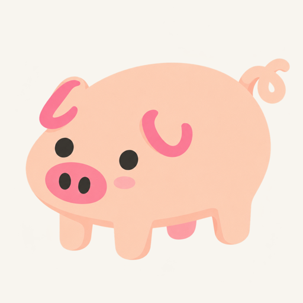

# 无描边普通猪样图 v1

状态：用户指出耳朵结构有问题，已进入修订；此版本保留为历史参考，不作为批量出图基准。这里只是审图预览，不是游戏成品。

最新：[v2 猪耳修订](piglet-no-outline-v2.md)。

- 工具：内置 `image_gen`，2026-10-11。
- 参考：已通过的 `piglet-idle-v1` 原尺寸 PNG；只改变画风，保持角色、站姿与构图。
- 原始生成文件标识：`exec-4f30f0b0-65c3-4dde-b765-f25be026bfed.png`。
- 原尺寸：1254 × 1254；生成结果原生透明底，alpha 范围 0–255。
- 本页 PNG：浅色底审图预览，缩至 512px；不作为游戏立绘。
- 逐字提示词：[piglet-idle-v1.txt](../../art-prompts/no-outline/piglet-idle-v1.txt)。
- 已自查：站姿与参考一致，四条腿、两只耳朵、完整卷尾，两只眼睛及两枚鼻孔；身体、耳朵、鼻子和尾巴无黑色轮廓；在浅色与深色背景检查过透明边缘。

批量范围与设置稿见 [立绘风格切换设计](../../design/pig-art-styles.md)。
