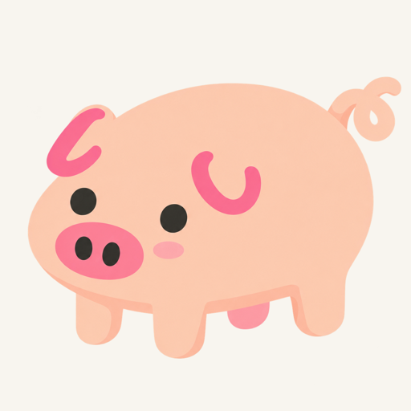

# 无描边普通猪 v3：保留原耳型的局部清理

状态：待用户审图；不作为游戏成品。

用户明确要求不能乱改耳朵：原耳型本来正确，仅需修小瑕疵。重新查看最初参考猪及反馈睡觉图，确认其使用简化的弯曲耳型。v3 用内置 `image_gen` 编辑 v1，并提供最初参考猪作为第二张参考，保留原有 C/U 弯曲耳型、位置与朝向，只清理 v1 新增的耳边桃色阴影和细小不齐；不再采用 v2 的改型方案。

- 工具：`image_gen`，2026-10-11；生成文件标识 `exec-fa80e538-fcf3-4475-8042-203eeb741613.png`。
- 原尺寸：1254 × 1254，透明 PNG，alpha 范围 0–255。
- 本页图片只是缩至 512px 的浅色审图预览，不是游戏成品。
- [逐字提示词](../../art-prompts/no-outline/piglet-idle-v3.txt)。
- 自查：弯曲耳型保留，没有换成垂耳；四腿、两眼、两枚鼻孔，卷尾完整；深浅背景均检查过。
- [v1](piglet-no-outline-v1.md)、[已否定的 v2](piglet-no-outline-v2.md)、[整体设计](../../design/pig-art-styles.md)。
